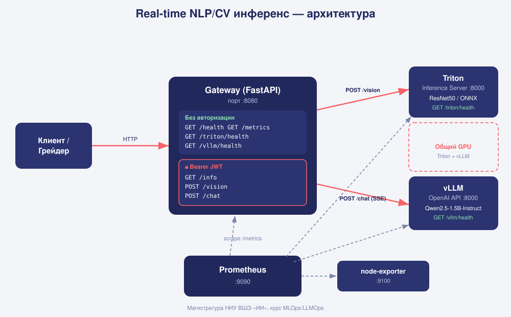

# ДЗ «Real-time NLP/CV инференс» — задание

Магистратура НИУ ВШЭ «Искусственный интеллект», курс MLOps/LLMOps. Автор — Чернов Евгений.

> Это **самодостаточный файл задания**: здесь всё, что нужно, чтобы выполнить и сдать ДЗ —
> требования, контракт API, критерии оценивания и порядок сдачи. Стартовый код (скелет) —
> в этом же каталоге.

---

## 1. О чём это

Вы уже умеете по отдельности поднимать **Triton Inference Server** и **vLLM**. В этом ДЗ вы
собираете из них один **продакшн-подобный real-time inference gateway**: единый сервис, который

- принимает **картинки** и классифицирует их (CV, Triton + модель **вашего варианта**),
- принимает **чат-запросы** и отвечает потоково (NLP, vLLM, стриминг токенов),
- закрыт **JWT-авторизацией**, отдаёт **Prometheus-метрики**, переживает **нагрузку**.

Проверять будет **автоматический грейдер** по строгому контракту. Он смотрит не только на
ответы ручек, но и на **метрики ваших Triton и vLLM**: решение «в обход» бэкендов (модель прямо
в gateway, заготовленные ответы чата, фейковые health-ручки) потеряет на этом большую часть баллов.

---

## 2. Что понадобится

- **NVIDIA GPU** + драйвер + [`nvidia-container-toolkit`](https://docs.nvidia.com/datacenter/cloud-native/container-toolkit/latest/install-guide.html)
  (проверка: `docker run --rm --gpus all ubuntu nvidia-smi` видит карту). Обе модели
  (CV-модель в Triton и LLM в vLLM) делят один GPU.
- **Docker** и **Docker Compose v2**.
- **Образ Triton — через зеркало NGC.** NVIDIA NGC (`nvcr.io`) отвечает `403 Forbidden` на
  запросы из РФ, поэтому берите `nvcr.io/nvidia/tritonserver:24.06-py3` (`linux/amd64`) из
  зеркала Нанкинского университета, **по digest** официального образа:
  ```
  nvcr.nju.edu.cn/nvidia/tritonserver@sha256:153d3158d96346bc50df7fa6e1c3a96d6dc638249072be20ebbbcae07b8505ca
  ```
  Digest — хеш содержимого: Docker сам проверит, что скачанный образ байт-в-байт совпадает
  с оригиналом NVIDIA. Запасное зеркало с тем же digest — `m.daocloud.io/nvcr.io/nvidia/tritonserver`.
  Образ большой (~8 ГБ) — скачайте его заранее (`docker pull ...`). vLLM берите с Docker Hub
  как обычно (`vllm/vllm-openai`, закрепите версию; эталон проверен на `v0.33.0`).
- **Python 3.10+** на хосте с модулем venv (`sudo apt install -y python3-venv`). `make init`
  сам создаст `.venv` и поставит туда torch/torchvision/onnx (CPU) для разовой генерации ONNX.
  `make variant` и `make token` работают на голом python3.
- Доступ к **Hugging Face** для скачивания весов `Qwen/Qwen2.5-1.5B-Instruct` (модель открытая;
  при необходимости задайте `HF_TOKEN` в `.env`).
- Ваш `base_url` должен быть **доступен грейдеру** на момент сдачи (публичный IP или туннель,
  например `ssh -R` / `cloudflared` / `ngrok`).

---

## 3. Что построить

### 3.1. Ваш вариант

CV-модель у каждого своя и зависит от email:

| Вариант | Веса torchvision |
|---|---|
| `resnet50` | `ResNet50_Weights.IMAGENET1K_V1` |
| `efficientnet_b0` | `EfficientNet_B0_Weights.IMAGENET1K_V1` |
| `mobilenet_v3_large` | `MobileNet_V3_Large_Weights.IMAGENET1K_V2` |
| `convnext_tiny` | `ConvNeXt_Tiny_Weights.IMAGENET1K_V1` |

Впишите свой **настоящий** email в `.env` (`STUDENT_EMAIL`) и выполните `make variant` — скрипт
напечатает вашу модель, её нужно прописать в `.env` как `CV_MODEL`. Грейдер считает вариант
по той же формуле из email, который отдаёт ваш `/info`, и сверяет ответы `/vision` с эталоном
**именно вашей** модели. LLM у всех одна — `Qwen2.5-1.5B-Instruct` в vLLM.

> Модели различаются не только весами, но и **препроцессингом**: размер ресайза, интерполяция
> и кроп у них разные. Скоры совпадут с эталоном, только если препроцессинг в gateway в
> точности повторяет официальный для ваших весов (`weights.transforms()` в torchvision).

### 3.2. Стек

В одном `docker-compose`: **Triton** (модель варианта) + **vLLM** (Qwen) + **FastAPI-gateway** +
**Prometheus** + **node-exporter**. Схема — на картинке:



Этот каталог — **скелет-рыба**: дан каркас и инфраструктура
(`Makefile`, скрипты варианта, экспорта модели и генерации JWT, `.env.example`,
`imagenet_classes.txt`, `Dockerfile`, `docker-compose` со `# TODO`). **Всё остальное — ваше:**

1. `docker-compose.yml` — дозаполнить сервисы (образы/команды Triton и vLLM, GPU, env gateway).
2. `model_repository/<CV_MODEL>/config.pbtxt` — вход/выход, `instance_group`, `dynamic_batching`
   (`INPUT__0` `[3,224,224]` FP32 NCHW → `OUTPUT__0` `[1000]`, `KIND_GPU`). Подсказки —
   в `model_repository/README.md`.
3. `gateway/main.py` — **все ручки контракта** (раздел 4): JWT-авторизация, `/info`, `/vision`
   (препроцессинг вашей модели → Triton → top-5), `/chat` (проксирование vLLM, SSE),
   `/triton/health`, `/vllm/health`, проброс метрик `/metrics/triton`·`/metrics/vllm`·`/metrics/node`.
   `/health` и `/metrics` в скелете есть.

> Полный контракт со схемами — [`API_CONTRACT.md`](API_CONTRACT.md); машиночитаемая версия —
> [`openapi.yaml`](openapi.yaml) (OpenAPI 3.0, откроется в Swagger UI / editor.swagger.io).

### 3.3. Быстрый старт

```bash
cp .env.example .env
# отредактируйте .env: свой JWT_SECRET (например: openssl rand -hex 32)
#                      и данные для /info (ФИО и НАСТОЯЩИЙ email)

make variant   # узнать свою CV-модель → вписать CV_MODEL=... в .env
make init      # venv + экспорт модели варианта → model_repository/<CV_MODEL>/1/model.onnx
make up        # поднять весь стек (первый запуск качает образы и веса Qwen — небыстро)
make ps        # дождаться, пока gateway healthy; vLLM грузит веса при первом старте
make token     # напечатать JWT (подписан вашим JWT_SECRET) — это Bearer для грейдера
make smoke     # локально дёрнуть свои ручки и убедиться, что всё отвечает
```

---

## 4. Контракт API (проверяется буквально)

Публичный вход — gateway, `base_url = http://HOST:8080` (порт любой — вы передаёте грейдеру
полный `base_url`). Ниже — главное; полные схемы в [`API_CONTRACT.md`](API_CONTRACT.md).

| Ручка | Auth | Ответ |
|---|---|---|
| `GET /health` | — | `{"status": "ok"}` |
| `GET /metrics` | — | Prometheus-метрики gateway |
| `GET /triton/health` | — | `{"backend": "triton", "ready": true, "model": "<CV_MODEL>"}`, `503` если не готов |
| `GET /vllm/health` | — | `{"backend": "vllm", "ready": true, "models": [...]}`, `503` если не готов |
| `GET /metrics/triton`, `/metrics/vllm`, `/metrics/node` | — | **сырые** метрики бэкендов, `502` если недоступен |
| `GET /info` | Bearer | студент (с email), `models.vision = CV_MODEL`, `models.llm`, `gpu` |
| `POST /vision` | Bearer | `multipart/form-data`, поле `file` → top-5 `{class_id, label, score}` |
| `POST /chat` | Bearer | OpenAI-подобный JSON → SSE-стрим, финал `data: [DONE]` |

Ключевые требования:

- **Авторизация** — JWT HS256, секрет `JWT_SECRET` ваш. Без токена, с мусором, с токеном,
  подписанным **чужим** секретом, и с неподписанным `alg=none` — всё это `401`. Валидный — `200`.
- **`/vision`**: ровно top-5 по убыванию `score` (softmax, 0..1); `class_id` — индекс строки в
  `gateway/imagenet_classes.txt` (`207 = golden retriever`). Принимает любые картинки, которые
  открывает Pillow — PNG с прозрачностью, оттенки серого, CMYK, огромные и крошечные. Пустой
  файл или не картинка — `400`, нет поля `file` — `422`, Triton недоступен — `502`.
- **`/chat`**: OpenAI-совместимые чанки `data: {json}` + пустая строка, поток **обязан**
  закончиться `data: [DONE]`. Ошибки — **HTTP-кодом**: `400` (нет `messages`, битый JSON, vLLM
  отклонил запрос — например, промпт длиннее контекста), `502` (vLLM недоступен). Не отдавайте
  `200` с ошибкой внутри стрима: грейдер считает такой ответ неуспешным.
- **Метрики бэкендов** отдавайте без изменений: грейдер сверяет по ним, что его запросы дошли
  до Triton и vLLM (`nv_inference_count`, `nv_inference_exec_count`, `nv_gpu_*`,
  `vllm:request_success_total`, `vllm:kv_cache_usage_perc` — в старых версиях vLLM
  `vllm:gpu_cache_usage_perc`).

> **Не меняйте** `gateway/imagenet_classes.txt`: он тот же, что у грейдера. У всех вариантов
> порядок классов совпадает с этим файлом.

---

## 5. Критерии оценивания (всего 100 баллов)

| # | Критерий | Баллы | Как проверяется |
|---|----------|:----:|-----------------|
| 1 | Наличие ручек | 10 | все ручки контракта отвечают `200`, `/info` по схеме, `/vision` и `/chat` работают |
| 2 | Авторизация | 10 | 4 вида поддельных токенов → `401` (по 2.5 балла), валидный → `200` |
| 3 | Корректность `/vision` | 15 | top-5 accuracy на мини-сете ≥ 0.8 (5) + top-1 скоры совпадают с эталоном **вашей** модели (10) |
| 4 | Латентность `/vision` | 5 | p95 одиночных запросов < 400 мс (сетевой RTT до сервера вычитается) |
| 5 | Стриминг `/chat` | 10 | ≥ 2 чанка и `[DONE]` (5) + TTFT < 2000 мс (5) |
| 6 | Корректность `/chat` | 10 | ответы LLM на случайные вопросы, которые меняются при каждой сдаче |
| 7 | Нагрузка | 15 | 20 параллельных × 20 c (микс vision + chat); доля успешных ≥ 0.95, без `5xx` |
| 8 | Устойчивость | 10 | нестандартные и битые входы — правильные ответы и коды (набор входов скрытый) |
| 9 | **Настоящие бэкенды** | 10 | счётчики в метриках Triton и vLLM выросли на число запросов грейдера + есть GPU-метрики |
| 10 | Dynamic batching | 5 | под нагрузкой Triton обрабатывает ≥ 1.5 картинки за один запуск модели (по его метрикам) |

**Оценка — набранные баллы** (0–100), учитывается **лучший** результат среди попыток.
Возможна устная защита: преподаватель может попросить показать стек, метрики в Prometheus
и объяснить свои настройки.

---

## 6. Как сдавать

Грейдер: **`http://51.250.34.2:9000`**. Сдача — HTTP-запрос к нему. Поднимите стек так, чтобы `base_url` был
доступен грейдеру, и отправьте JWT вместе с **персональным ключом сдачи** — его выдаёт
преподаватель, он привязан к вашему email. Запускайте из каталога проекта, чтобы токен
подставился сам (при ручном копировании легко захватить лишний символ — и получить 401):

```bash
curl -s -X POST http://51.250.34.2:9000/submit \
  -H "Content-Type: application/json" \
  -H "X-Submit-Key: <ваш-ключ>" \
  -d "{\"base_url\": \"http://<ваш-host>:8080\", \"token\": \"$(make -s token)\"}"
```
Ответ — JSON; чтобы читать его с отступами и кириллицей, допишите
`| python3 -m json.tool --no-ensure-ascii`.

> **У вас 5 попыток на всё ДЗ.** Это не отладчик: всё, что проверяет грейдер, можно проверить
> локально (раздел 8). Сдавайте, когда самопроверка проходит целиком.

- Грейдер дёрнет ваш `/info` (запомнит, кто сдаёт, и определит вариант), прогонит критерии 1–10
  и вернёт **JSON**:
  ```json
  {"submission_id": "...", "total_score": 87, "max_score": 100,
   "backends_verified": true, "variant": {"assigned": "efficientnet_b0", "declared": "efficientnet_b0"},
   "attempts_used": 2, "attempts_left": 3,
   "criteria": [{"id": 1, "name": "endpoints", "score": 10, "max": 10, "ok": true, "details": "..."}],
   "errors": []}
  ```
- В `details` каждого критерия написано, что именно не так — читайте его.
- **Лимит — 5 засчитанных попыток на студента за всё ДЗ.** Считается по email из вашего
  `/info`, поэтому смена хоста, туннеля или IP новых попыток не даёт. Когда попытки
  закончились — `429`. В оценку идёт **лучшая** из попыток.
- Попытка **не списывается**, если проверка не запустилась: сервер недоступен (`400`),
  `/info` не отвечает или не по контракту (`400`), нет ключа (`401`), ключ не подходит к
  email из `/info` (`403`), кривой `base_url` (`400`). Пока идёт проверка, вторая сдача
  получит `409`.
- Ключ привязан к email: в `STUDENT_EMAIL` должен быть ровно тот адрес, на который он выдан.

**Сколько попыток осталось и что было в прошлых** — ручка `/me`, попытку не тратит:

```bash
curl -s http://51.250.34.2:9000/me \
  -H "X-Student-Email: <ваш-email>" \
  -H "X-Submit-Key: <ваш-ключ>"
```
В ответе: ваш вариант, `attempts_used` / `attempts_left`, лучшая попытка и история всех
сдач с баллами и `details` по каждому критерию.

---

## 7. Подводные камни (частые потери баллов)

- **Не блокируйте event loop.** Препроцессинг картинки и синхронный клиент Triton внутри
  `async def` останавливают весь gateway: пока считается одна картинка, стоят все остальные
  запросы и стримы `/chat`. Под нагрузкой это видно по TTFT, а Triton получает запросы строго
  по одному — батчи не собираются (критерий 10).
- **Dynamic batching надо настроить, а не просто включить.** Окно `max_queue_delay_microseconds`
  определяет, сколько Triton ждёт соседние запросы. Подберите его по метрикам
  (`nv_inference_count` / `nv_inference_exec_count`) так, чтобы батчи собирались, а латентность
  оставалась в SLO.
- **Препроцессинг — ровно как у ваших весов.** «Как у ResNet» для любой модели, другая
  интерполяция или ресайз сразу в 224 дают правильный класс, но не те скоры — критерий 3.
- **Имя модели в Triton = `CV_MODEL`.** По нему грейдер ищет счётчики в метриках Triton.
  Загружайте в Triton только модель своего варианта.
- **Не добавляйте свой rate limiter на `/vision` и `/chat`.** Доступ и так закрыт JWT, а
  нагрузочный тест с `429` провалит критерий 7.
- **Имя модели в vLLM.** По умолчанию vLLM регистрирует модель под HF-путём
  (`Qwen/Qwen2.5-1.5B-Instruct`). Gateway шлёт `model: "Qwen2.5-1.5B-Instruct"` — задайте
  `--served-model-name Qwen2.5-1.5B-Instruct`, иначе vLLM вернёт 404.
- **Деление GPU.** Обе модели на одном GPU: ограничьте vLLM (`--gpu-memory-utilization`,
  `--max-model-len`), чтобы осталась память Triton.
- **Ошибки — честными кодами.** Сначала откройте запрос к vLLM и проверьте статус, потом
  начинайте стрим: после первого отправленного байта код ответа уже не поменять.
- **Доступность `base_url`.** Грейдер обращается снаружи — проверьте `curl` с другой машины.
- **Свежесть токена.** JWT с `exp` в прошлом → 401. Генерируйте токен перед сдачей.

---

## 8. Самопроверка перед сдачей

- [ ] `make variant` печатает ✔ — `CV_MODEL` в `.env` совпадает с вариантом.
- [ ] `make ps` — gateway healthy, Triton и vLLM подняты.
- [ ] `curl $BASE/health` → `{"status":"ok"}` (в т.ч. **с другой машины**).
- [ ] `curl -H "Authorization: Bearer $TOKEN" $BASE/info` → ваши ФИО/email, `models.vision` = ваш вариант.
- [ ] `curl $BASE/info` без токена и с токеном, подписанным другим секретом, → `401`.
- [ ] `curl -H "Authorization: Bearer $TOKEN" -F file=@cat.jpg $BASE/vision` → top-5 с верным `class_id`;
      скоры совпадают с тем, что даёт torchvision с `weights.transforms()` на той же картинке.
- [ ] PNG с прозрачностью и картинка в оттенках серого → `200`; текстовый файл вместо картинки → `400`.
- [ ] `/chat` со `"stream": true` → идут чанки и `data: [DONE]`; на «What is 37 + 48?» модель отвечает 85.
- [ ] `/chat` с промптом длиннее контекста → `400`, а не `200` и не `5xx`.
- [ ] `curl $BASE/metrics/triton | grep nv_inference_count` → счётчик вашей модели растёт после `/vision`.
- [ ] Под параллельной нагрузкой `nv_inference_count` растёт быстрее, чем `nv_inference_exec_count`.
- [ ] Prometheus (`:9090`) → *Targets*: gateway/triton/vllm/node-exporter — `UP`.
